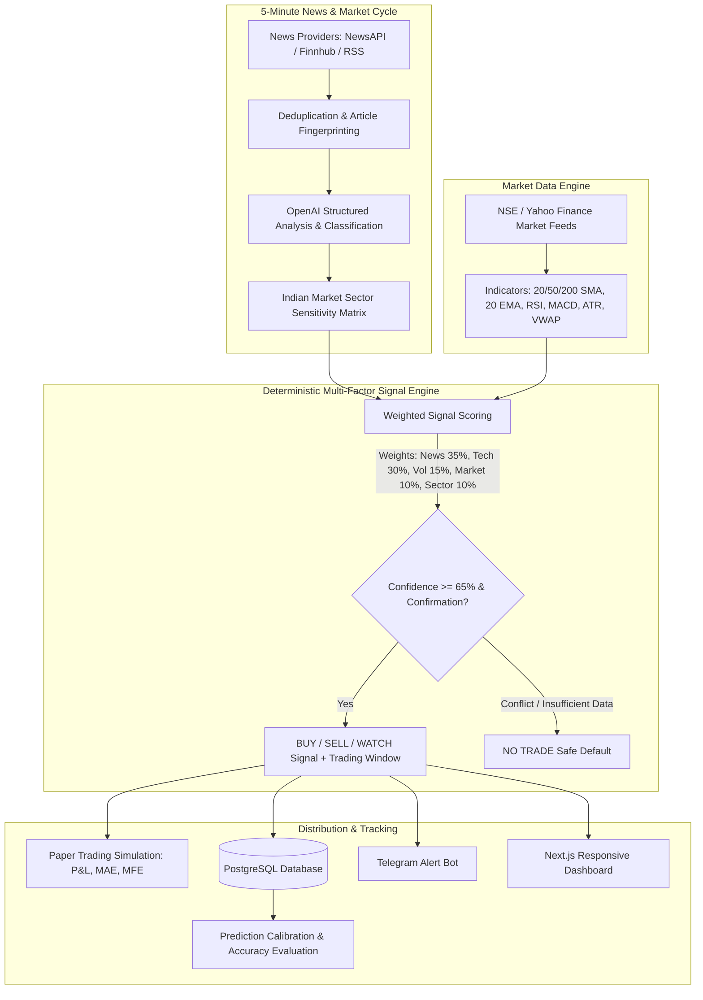
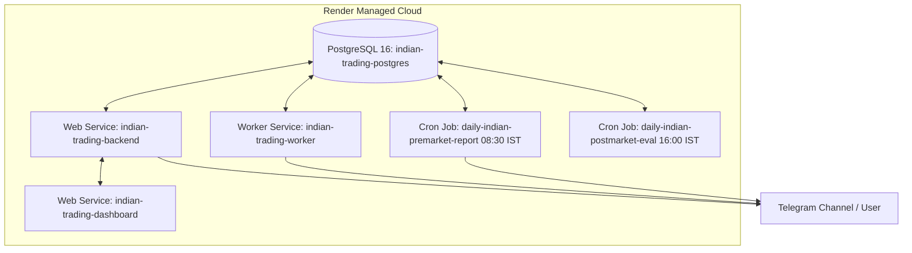

# AI-Powered Indian Stock Market Intelligence & Trading Decision Support

[](#important-trading-safety-rules)
[](LICENSE)
[](https://python.org)
[](https://fastapi.tiangolo.com)
[-black)](https://nextjs.org)

> **IMPORTANT TRADING SAFETY NOTICE**  
> This application operates strictly in **PAPER TRADING / SIGNAL-ONLY mode**. It does **NOT** place real trades automatically. Real order execution is permanently disabled by system architecture. Predictions and signals are probabilistic algorithmic estimates for educational decision-support only. The system **NEVER** claims guaranteed returns or 100% accuracy.

---

## Architecture Overview



---

## Complete Project File Tree

```
Trading Asistent/
├── .env.example                       # Complete environment variable template
├── .env                               # Local active environment configuration
├── docker-compose.yml                 # Local multi-container orchestration
├── render.yaml                        # Production Render Blueprint configuration
├── README.md                          # Documentation and run instructions
├── docker/
│   ├── Dockerfile.backend             # FastAPI production image
│   ├── Dockerfile.worker              # Background worker image
│   └── Dockerfile.frontend            # Next.js multi-stage build image
├── backend/
│   ├── requirements.txt               # Pinned Python dependencies
│   ├── run.py                         # Local backend execution script
│   ├── app/
│   │   ├── __init__.py
│   │   ├── main.py                    # FastAPI app factory, CORS, security middlewares
│   │   ├── core/
│   │   │   ├── config.py              # Pydantic v2 BaseSettings & validation
│   │   │   ├── database.py            # SQLAlchemy 2.0 async engine & session
│   │   │   ├── logging.py             # Structured logging formatter
│   │   │   └── security.py            # Safety checks & prohibited phrase guards
│   │   ├── models/
│   │   │   ├── base.py                # Base declarative & timestamp mixins
│   │   │   ├── market.py              # Stock, Sector, MarketDataSnapshot
│   │   │   ├── news.py                # NewsArticle, NewsAnalysis, NewsEntity
│   │   │   ├── signal.py              # Signal with multi-factor breakdown
│   │   │   ├── paper_trading.py       # PaperTrade simulation tracking
│   │   │   ├── prediction.py          # PredictionResult evaluation records
│   │   │   ├── report.py              # DailyReport and Alert
│   │   │   ├── system.py              # SystemLog, ApiUsage, SystemSetting, User
│   │   │   └── seed.py                # Indian sectors & NIFTY 50 seed data
│   │   ├── schemas/
│   │   │   ├── common.py              # APIResponse, PaginatedResponse, Disclaimer
│   │   │   ├── news.py                # News schemas with Pydantic v2 ConfigDict
│   │   │   ├── market.py              # Stock & Sector read schemas
│   │   │   ├── signal.py              # Signal read & weight update schemas
│   │   │   ├── paper_trading.py       # Paper trade & metrics schemas
│   │   │   ├── report.py              # Daily report read schemas
│   │   │   └── system.py              # HealthStatus, ReadinessStatus, Metrics
│   │   ├── api/
│   │   │   ├── router.py              # Master API router
│   │   │   └── v1/
│   │   │       ├── health.py          # /health, /ready, /metrics, /disclaimer
│   │   │       ├── news.py            # /news, /news/{id}, /news/refresh
│   │   │       ├── signals.py         # /signals, /signals/top, /signals/generate
│   │   │       ├── market.py          # /market/stocks, /market/sectors
│   │   │       ├── paper_trading.py   # /paper-trading/positions, /metrics
│   │   │       ├── reports.py         # /reports/pre-market/latest
│   │   │       ├── performance.py     # /performance/predictions, /summary
│   │   │       └── settings.py        # /settings, /settings/weights
│   │   └── workers/
│   │       ├── tasks.py               # 5-min news cycle & pre-market report tasks
│   │       └── scheduler.py           # AsyncIOScheduler cron jobs
│   └── tests/
│       ├── conftest.py                # In-memory SQLite async test fixtures
│       ├── test_config.py             # Config & safety phrase tests
│       ├── test_health.py             # /health, /ready, /metrics tests
│       ├── test_database.py           # Database seeding & models test
│       └── test_api.py                # End-to-end API integration tests
└── frontend/
    ├── package.json                   # Next.js 14, Tailwind, Lucide React
    ├── tsconfig.json                  # TypeScript configuration
    ├── tailwind.config.js             # Financial terminal dark theme
    ├── postcss.config.js
    ├── next.config.js                 # API rewrites & optimization
    └── src/
        ├── lib/
        │   ├── api.ts                 # Type-safe API client
        │   └── types.ts               # Core TypeScript definitions
        ├── components/
        │   ├── Navbar.tsx             # IST market clock & cycle trigger
        │   ├── Sidebar.tsx            # Navigation sidebar
        │   └── DisclaimerBanner.tsx   # Persistent regulatory disclaimer
        └── app/
            ├── globals.css            # Dark terminal styling
            ├── layout.tsx             # Root layout with persistent header/sidebar
            ├── page.tsx               # Redirect to /dashboard
            ├── dashboard/page.tsx     # Executive overview & active setups
            ├── news/page.tsx          # 5-minute news feed with sentiment
            ├── signals/page.tsx       # Deterministic signal engine table
            ├── watchlist/page.tsx     # Top setups & No-Trade watchlist
            ├── market/page.tsx        # Sector sensitivity matrix & stocks
            ├── performance/page.tsx   # Prediction calibration & paper P&L
            ├── settings/page.tsx      # Scoring weights & thresholds
            └── system-health/page.tsx # Liveness, DB status, API metrics
```

---

## Development Roadmap & Phases

- [x] **Phase 1: Foundation & Core Architecture**
  - FastAPI backend with async database support (PostgreSQL ready + SQLite zero-config fallback)
  - Full ORM schema (14 tables with indexes on `published_at`, `symbol`, `event_type`, `created_at`)
  - Indian market sector sensitivity matrix & NIFTY 50 seed data
  - Next.js 14 responsive trading terminal dashboard (8 responsive pages)
  - Mandatory safety rules & prohibited phrase validation engine
- [x] **Phase 2: Modular News Engine & Deduplication**
  - AbstractNewsProvider interface with RSS, NewsAPI, and Mock providers
  - Multi-feed RSS scraper (Moneycontrol, Economic Times, Livemint, Business Standard)
  - Deduplication pipeline: URL tracking parameter stripping, title token similarity (Jaccard), and SHA-256 fingerprinting
  - Section 5 News classification & Indian equity ticker extraction
  - Preliminary sentiment and market impact pre-scoring gate
- [x] **Phase 3: OpenAI Structured Analysis & Fact vs. Speculation**
  - GPT-4o-mini structured JSON extraction with strict schema adherence
  - Epistemic segregation of confirmed facts, market interpretation, speculation, and risk factors
  - Token cost tracking with pre-filtering gate and $5.00 daily budget cap
  - Deterministic fallback when OpenAI API is unavailable or budget is reached
- [x] **Phase 4: Market Data & Technical Indicator Pipeline**
  - Live and historical OHLCV feeds with NSE session status logic (Pre-open, Regular, Opening Volatility, Roll-over, Post-close)
  - Pure NumPy/Pandas indicators: 20/50/200 SMA, 20 EMA, RSI 14, MACD (12, 26, 9), ATR 14, VWAP, Volume surge ratio, Classic & Camarilla Pivots
  - Technical confirmation gate: signals strictly blocked without technical alignment ("Never trade on news alone")
- [x] **Phase 5: Deterministic Signal Engine & Paper Trading Simulation**
  - Multi-factor scoring: News (35%), Technicals (30%), Volume (15%), Market Trend (10%), Sector Sensitivity (10%)
  - Dynamic entry zones, ATR stop loss, Target 1 (1.5x risk) and Target 2 (2.5x risk)
  - Execution windows: opening volatility buffer (09:15-09:30), intraday square-off cutoff (15:15 IST)
  - Paper trading simulation: 2% capital risk position sizing, trailing stop to breakeven at Target 1, MAE/MFE tracking
- [x] **Phase 6: Telegram Bot Integration & Threshold-Gated Alerts**
  - Interactive bot commands: `/start`, `/help`, `/status`, `/news`, `/top`, `/signals`, `/watchlist`, `/performance`, `/papertrade`, `/report`
  - Breaking news alert threshold: impact score >= 70
  - High-conviction signal alert threshold: composite score >= 70
- [x] **Phase 7: Pre-Market Indian Stock Market Daily Report**
  - Automated 08:30 IST (03:00 UTC) report generator synthesizing: Global Overnight Summary, Top Catalysts (Facts vs. Speculation), NIFTY 50 / BANK NIFTY pivot levels & expected open, High-Conviction Watchlist (3-5 stocks), No-Trade Watchlist (2-4 stocks), and Actionable Risk Warnings
  - Dedicated `/reports` dashboard page with interactive JSON inspection and Telegram broadcast
- [x] **Phase 8: Prediction Evaluation & Backtesting Engine**
  - Automated post-market outcome evaluation measuring directional accuracy, win rate, and Brier calibration score
  - Rolling strategy backtesting across historical OHLCV daily candles with zero look-ahead bias
  - Comprehensive KPI ribbon, confidence calibration comparison buckets, and sector accuracy breakdown
- [x] **Phase 9: Render Deployment & Docker Multi-Container Architecture** *(Current Release)*
  - Render Blueprint specification (`render.yaml`) orchestrating 5 services & managed PostgreSQL 16
  - Production-hardened Dockerfiles (`Dockerfile.backend`, `Dockerfile.worker`, `Dockerfile.frontend`) with non-root security and healthcheck probes
  - `docker-compose.yml` orchestrating local PostgreSQL, Redis, Backend, Worker, and Next.js frontend
  - Standalone cron runner scripts in `backend/scripts/` (`run_pre_market.py`, `run_evaluation.py`, `run_worker.py`)
- [ ] **Phase 10: Security Hardening & Cost Optimization**

---

## Quickstart & Local Development

### 1. Prerequisites
- Python 3.11+ or 3.13
- Node.js 18+ or 20+ (with npm)
- Git

### 2. Windows Local Setup

Open PowerShell in the project directory:

```powershell
# 1. Setup Python Virtual Environment
py -m venv venv
.\venv\Scripts\Activate.ps1

# 2. Install Python Dependencies
pip install -r backend/requirements.txt

# 3. Copy Environment Template
Copy-Item .env.example .env

# 4. Run Backend Pytest Suite (123 tests)
.\venv\Scripts\python.exe -m pytest backend/tests -v

# 5. Start FastAPI Backend (Runs at http://127.0.0.1:8000)
.\venv\Scripts\python.exe backend/run.py
```

In a second PowerShell window, launch the Next.js frontend:

```powershell
cd frontend
npm install
npm run dev
# Dashboard opens at http://localhost:3000
```

### 3. Docker Compose Local Multi-Container Deployment

Run the complete multi-service stack (Database, Cache, API Backend, Background Worker, and Frontend) locally with one command:

```bash
# 1. Configure environment variables
cp .env.example .env

# 2. Start all services in detached mode
docker compose up -d --build

# 3. View running container logs
docker compose logs -f

# 4. Check service status
docker compose ps
```

The stack exposes:
- **Next.js Financial Dashboard**: `http://localhost:3000`
- **FastAPI Backend & Swagger Docs**: `http://localhost:8000/docs`
- **Health Probe**: `http://localhost:8000/health`
- **PostgreSQL Database**: `localhost:5432`
- **Redis Cache**: `localhost:6379`

To stop the containers:
```bash
docker compose down
```

---

## Render Cloud Deployment Guide (1-Click Blueprint)

The application includes a production-grade Infrastructure-as-Code Blueprint (`render.yaml`) ready for automated deployment on [Render](https://render.com).

### Architecture on Render



### 1-Click Deployment Steps

1. **Fork or Push** this repository to your GitHub or GitLab account.
2. Sign in to your **Render Dashboard** (`dashboard.render.com`).
3. Click **New +** > **Blueprint**.
4. Connect your repository and select the `master` (or `main`) branch.
5. Render will automatically detect `render.yaml` and configure:
   - **`indian-trading-postgres`**: Managed PostgreSQL 16 database.
   - **`indian-trading-backend`**: FastAPI Web Service with `/health` probe.
   - **`indian-trading-worker`**: Persistent background worker running 5-minute news ingestion & signal updates.
   - **`indian-trading-dashboard`**: Next.js 14 App Router web service.
   - **`daily-indian-premarket-report`**: Cron job at 08:30 IST (03:00 UTC) Mon-Fri.
   - **`daily-indian-postmarket-eval`**: Cron job at 16:00 IST (10:30 UTC) Mon-Fri.
6. Provide the secret environment variables in the Render Blueprint UI:
   - `OPENAI_API_KEY`: Your OpenAI API key for structured analysis.
   - `TELEGRAM_BOT_TOKEN`: Your Telegram Bot token from `@BotFather`.
   - `TELEGRAM_CHAT_ID`: Your Telegram group/channel/user ID.
   - `NEWS_API_KEY`: *(Optional)* NewsAPI key (RSS feeds operate without an API key).
7. Click **Apply**. Render will provision all resources, run database migrations and seeding, and output the live dashboard URL!

---

## Standalone CLI Scripts

For manual execution or custom cron triggers, standalone CLI scripts are provided in `backend/scripts/`:

```bash
# Generate Pre-Market Indian Stock Market Report immediately
python backend/scripts/run_pre_market.py

# Evaluate prediction calibration and settlement outcomes immediately
python backend/scripts/run_evaluation.py

# Run standalone background worker service
python backend/scripts/run_worker.py
```

---

## Example API Responses

### 1. Liveness & Safety Probe (`GET /health`)
```json
{
  "status": "ok",
  "version": "1.0.0",
  "environment": "development",
  "mode": "PAPER_TRADING_ONLY",
  "real_orders_enabled": false,
  "timestamp": "2026-10-28T16:15:00Z",
  "database": "connected",
  "ai_status": "configured",
  "paper_trading_safety": "ENFORCED"
}
```

### 2. Actionable Signal Payload (`GET /api/v1/signals/top`)
```json
{
  "success": true,
  "message": "Retrieved top 1 ranked setups",
  "data": [
    {
      "symbol": "RELIANCE.NS",
      "direction": "BUY",
      "entry_zone": "₹2920 - ₹2935",
      "entry_price": 2925.0,
      "stop_loss": 2890.0,
      "target_1": 2990.0,
      "target_2": 3040.0,
      "risk_reward": "1:2.0",
      "entry_time_window": "After 09:30 IST upon technical confirmation",
      "exit_time_window": "Before 15:15 IST",
      "confidence": 74,
      "news_score": 80.0,
      "technical_score": 70.0,
      "composite_score": 73.5,
      "reasoning": "Strong quarterly performance combined with breakout above 50 SMA.",
      "invalidated_if": "Falls below 2890 or broader market faces severe weakness.",
      "technical_confirmation": "RSI at 59, 20 EMA crossing above 50 SMA on 15m chart",
      "status": "PENDING"
    }
  ],
  "disclaimer": "PAPER TRADING / SIGNAL-ONLY MODE. Decision-support intelligence only."
}
```

### 3. Sector Macro Sensitivity Matrix (`GET /api/v1/market/sectors`)
```json
{
  "success": true,
  "data": [
    {
      "name": "Information Technology",
      "description": "IT services, SaaS, consulting and enterprise software",
      "sensitivities": {
        "us_markets_up": "BULLISH",
        "us_markets_down": "BEARISH",
        "us_tech_weakness": "BEARISH",
        "inr_depreciation": "BULLISH",
        "inr_appreciation": "BEARISH"
      }
    },
    {
      "name": "Paints & Specialty Chemicals",
      "description": "Decorative paints, coatings, and specialty chemical derivatives",
      "sensitivities": {
        "crude_oil_up": "BEARISH",
        "crude_oil_down": "BULLISH"
      }
    }
  ]
}
```

---

## Important Trading Safety Rules

1. **NO GUARANTEED OUTCOMES**: The application code strictly filters out prohibited claims such as *"Guaranteed profit"*, *"100% accurate"*, or *"Risk-free trade"*.
2. **SAFE DEFAULTS (NO TRADE)**: Whenever news is conflicting, market data is unavailable, or model confidence is below threshold, the engine defaults to **NO TRADE**.
3. **NEVER TRADE ON NEWS ALONE**: Technical indicators and volume momentum must confirm news direction before a BUY/SELL signal is issued.
4. **VIRTUAL CAPITAL ONLY**: In Phase 1, virtual paper orders are simulated to compute Maximum Adverse Excursion (MAE), Maximum Favorable Excursion (MFE), and prediction accuracy without any real financial risk.
